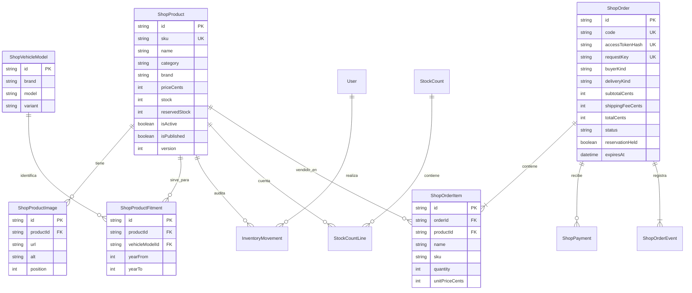

# Repuestos: modelo de datos y recorrido de venta

## Alcance

La tienda vende el inventario del taller a particulares y mecánicos. Cada SKU corresponde a una pieza o variante vendible y comparte sus existencias con el trabajo del taller. Los modelos del catálogo de compatibilidades son independientes de las motos y los datos personales de los clientes de turnos.

## Reglas del catálogo

- SKU único; una pieza con distinta medida, marca o variante vendible usa su propio SKU y stock.
- Las fotos tienen orden único por producto y texto alternativo. La gestión admite hasta seis. La imagen se sirve con el optimizador del sitio; se permiten fuentes específicas y rutas locales de imágenes, no cualquier dirección arbitraria.
- Marca, modelo y versión de moto forman una identidad única. Se normalizan al guardar. La relación producto/modelo es única y puede acotarse con años inicial/final. El rango de años se valida en la aplicación y PostgreSQL.
- Las compatibilidades se cargan únicamente después de comprobar la referencia real. No se deducen de cilindrada ni de ejemplos ficticios.
- El texto de compatibilidad anterior se conserva para las fichas existentes. El filtro por moto usa las relaciones estructuradas.
- Fotos y compatibilidades se guardan en una transacción y verifican la versión de la ficha. Un conflicto no borra parcialmente lo guardado.
- La publicación y el estado activo siguen separados: para aparecer en la tienda se requieren ambos.

## Stock y pedidos

La disponibilidad es `stock - reservedStock`. Crear el pedido reserva unidades durante treinta minutos, sin consumir todavía el stock físico. Los movimientos de inventario y las reservas comparten el mismo producto.

El servidor verifica publicación, disponibilidad, precios y costo de envío dentro de la transacción. La clave de intento evita duplicar pedidos ante reintentos. Cada ítem guarda nombre, SKU, cantidad y precio de esa compra, para que cambiar después la ficha no altere el historial.

El pago tiene su propia relación con el pedido; no se confunde con las señas de turnos. Se verifica contra el proveedor antes de entregar. El despacho o retiro consume el stock físico con un movimiento de venta único. Pagos tardíos, adicionales, devueltos o con contracargo requieren revisión del taller. La liberación de pedidos vencidos se mantiene en el servicio existente y debe ejecutarse periódicamente en el despliegue.

Las tablas del catálogo siguen la política de acceso del backend. Las páginas públicas seleccionan sólo información de venta; no exponen ubicación de almacén, movimientos internos ni datos de los clientes.

## Recorrido implementado

1. Catálogo: búsqueda por palabras, código y compatibilidad; tildes equivalentes; filtro por modelo/año, disponibilidad y orden de precios.
2. Ficha: fotos, referencia, disponibilidad, descripción y modelos compatibles.
3. Carrito propio: cantidades, problemas por artículo y total. En celular hay acceso persistente desde el catálogo.
4. Entrega y contacto: primero retiro/envío y cobertura postal; después dirección y contacto.
5. Revisión: productos, cantidades, entrega, contacto y total antes de reservar el pedido.
6. Pago y seguimiento: enlace privado copiable, consulta manual y comprobaciones automáticas acotadas mientras espera pago.

El carrito conserva sólo productos y cantidades en el navegador. El borrador de contacto se conserva en la sesión por hasta dos horas, y el enlace del último pedido por hasta veinticuatro horas; no se almacenan datos de tarjeta. Volver a una compra vencida permite reconstruir el carrito y exige revalidar precios y disponibilidad.

## Operación pendiente del catálogo real

La cobertura inicial de envío es exclusivamente la ciudad de Salta. El checkout muestra Salta como ciudad y provincia; el servidor verifica ambos datos y el CP 4400, incluso si alguien modifica el formulario. El retiro en taller sigue disponible para compradores de otras localidades. El costo permanece configurable. La cobertura local actual y los ejemplos usan CP 4400, informado por la [Municipalidad de Salta](https://municipalidadsalta.gob.ar/).

Antes de abrir ventas, cargar fotos reales, referencias y compatibilidades comprobadas; configurar Mercado Pago y probar su regreso/webhook; definir la coordinación de los envíos locales y programar el vencimiento de reservas. Esta iteración no incorpora transportistas automáticos, descuentos profesionales, facturación ni correos de confirmación de compras.

El catálogo público actual tiene un límite de mil productos. Si el volumen crece, pasar la búsqueda y paginación al servidor antes de ampliar ese límite.
